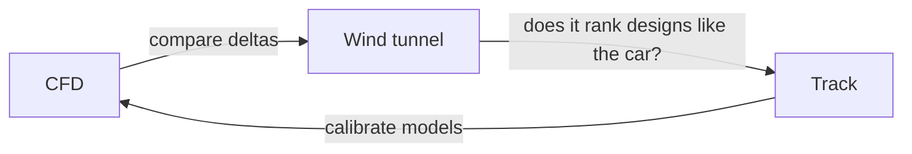

# Red Bull Aerodynamics Assessment: Revision Guide

Oct 9, 2026 · @Dhanya

## How to use this guide

This guide builds from basic fluid mechanics up to F1-specific aerodynamics, in the order an assessment tends to build on it. I can't verify Red Bull's exact format, so it covers what F1 aero internship assessments usually test: theory questions, interpreting plots or data, quick estimates, and a design or case discussion.

| What they are likely to test | What you should be able to do | Parts |
| --- | --- | --- |
| Theory questions | Explain downforce, drag, separation and vortices from first principles | 1-4 |
| Plot and data interpretation | Read Cp plots, total-pressure maps and force data, and say what is happening | 4, 5, 11 |
| Quick estimates | Calculate downforce and lap-time sensitivities by hand | 2, 8 |
| Design trade-offs and a case | Argue circuit trade-offs and use the 2026 active aero modes | 6-8 |
| Tools and methods | Discuss CFD, wind tunnel and Python workflows and their limits | 9-11 |
| Interview | Talk about your projects, Red Bull and behavioural questions | 12, 14 |

**How to study each part**

1. Read it once, then close it and explain the main idea aloud in 60 seconds.
2. Redo every worked calculation by hand without looking.
3. Answer the "Check yourself" questions at the end of each part before reading the answers in Part 13.
4. Note anything you cannot explain simply. That is where an interviewer will probe.

**One caution on facts.** The 2026 regulations and Red Bull's season were researched on 9 October 2026 and change quickly. Check the latest news and your assessment's own instructions before the day.

## Part 1: Fluid fundamentals from scratch

Almost all of F1 aerodynamics follows from four ideas: air has pressure, density and viscosity; mass is conserved; energy is conserved along a streamline; and forces change momentum.

### The properties of air

- **Density (ρ)** is about 1.2 kg/m³ at sea level and 15°C. It falls with altitude and heat, so Mexico City (about 2,240 m) has roughly 20% less downforce and drag for the same car.
- **Pressure (p)** is force per unit area, in pascals (N/m²). Atmospheric pressure is about 101,325 Pa. Aerodynamic forces come from small differences from that, over large areas.
- **Viscosity (μ)** is about 1.8×10⁻⁵ Pa·s. It is air's internal friction, and it is the reason boundary layers exist.
- **Speed of sound** is about 340 m/s. At 350 km/h (97 m/s) the Mach number is about 0.29, so F1 flow is treated as incompressible for most work (density changes below about 5%).

### Static, dynamic and total pressure

Dynamic pressure is the kinetic energy per unit volume of the flow. It is the quantity that scales every aerodynamic force on the car.

```latex
q = \tfrac{1}{2}\rho V^2
```

Bernoulli's equation says static plus dynamic pressure stays constant along a streamline, in steady flow without losses.

```latex
p + \tfrac{1}{2}\rho V^2 = p_0
```

The consequence you will use constantly: where air speeds up, static pressure drops. The underside of a wing and the floor of the car accelerate the air, so they pull the car down by suction.

Bernoulli fails where there are losses. Total pressure p₀ drops through viscous wakes and vortices, which is why total-pressure maps are used to find losses (Part 11).

### Continuity: why narrowing channels speed the flow

Mass cannot be created or destroyed. For incompressible flow in a channel, the same volume flows through every cross-section each second.

```latex
A_1 V_1 = A_2 V_2
```

A narrowing passage (a Venturi, like a floor tunnel) therefore speeds the air up and lowers its pressure. A widening passage (a diffuser) slows it and raises pressure back towards ambient.

### Momentum: the other way to see lift

Force equals the rate of change of momentum. A wing deflects air one way, and the air pushes the wing the other way (Newton's third law). Pressure differences and momentum change describe the same force from two angles, so they never conflict.

Avoid the "equal transit time" explanation (air over the longer side must travel faster to catch up). It is wrong, and interviewers notice.

### Reynolds number

Reynolds number is the ratio of inertial to viscous forces. It decides whether a boundary layer stays smooth (laminar) or becomes turbulent, and how stubbornly it resists separating.

```latex
Re = \frac{\rho V L}{\mu}
```

**Worked example.** A front-wing element with a 0.3 m chord at 80 m/s (288 km/h): Re = 1.2 × 80 × 0.3 / 1.8×10⁻⁵ = 1.6×10⁶. Using the whole car length (about 5 m) gives about 2.7×10⁷. Both are firmly in the turbulent regime.

### What Reynolds number means

Reynolds number tells you which forces are in charge of the flow: inertia (the air's tendency to keep moving) or viscosity (its internal friction). Estimate each force from the same quantities and their ratio is the Reynolds number.

```latex
\frac{\text{inertial force}}{\text{viscous force}} \sim \frac{\rho V^2 L^2}{\mu V L} = \frac{\rho V L}{\mu} = Re
```

The ranges below are rules of thumb, not sharp boundaries.

- **Low Re (below about 10³):** viscosity dominates. The flow is smooth and "sticky" and follows the surface, as with honey or a tiny insect's wing.
- **Middle Re (about 10⁴ to 10⁶):** the flow is sensitive. Boundary layers may be laminar, may separate and reattach, and small changes in speed, roughness or shape change the result.
- **High Re (above about 10⁶):** inertia dominates. Boundary layers are thin and mostly turbulent, wakes are large, and coefficients change only slowly with Re. Most of an F1 car sits here, with a few small parts in the sensitive range.

### The equation and its variables

There are two equivalent forms. The second uses kinematic viscosity, ν = μ / ρ, which combines density and viscosity into one property.

```latex
Re = \frac{\rho V L}{\mu} = \frac{V L}{\nu}, \qquad \nu = \frac{\mu}{\rho}
```

| Symbol | Meaning | SI unit | Typical value (sea level, 15°C) | If it doubles, Re |
| --- | --- | --- | --- | --- |
| ρ | Air density | kg/m³ | 1.2 (1.225 standard) | Doubles |
| V | Speed relative to the air | m/s | About 80 in the examples; 97 at 350 km/h | Doubles |
| L | Characteristic length: chord, diameter or car length | m | 0.02 to 5 | Doubles |
| μ | Dynamic viscosity | Pa·s | 1.8×10⁻⁵ | Halves |
| ν | Kinematic viscosity (μ / ρ) | m²/s | 1.5×10⁻⁵ | Halves |

Re is dimensionless. Check the units cancel:

```latex
\frac{(\mathrm{kg/m^3})(\mathrm{m/s})(\mathrm{m})}{\mathrm{kg/(m\,s)}} = 1
```

A **local** Reynolds number, Re\_x = ρVx / μ, uses the distance x from the leading edge and tells you how far a boundary layer has developed. A **global** Reynolds number, Re\_L, uses one length for the whole body.

### What changes Reynolds number

1. **Speed.** Re is proportional to V, so it changes around the lap. A 0.3 m wing element at 100 km/h has Re = 5.6×10⁵, about a third of its value at 288 km/h (1.6×10⁶).
2. **Length scale.** Re depends on the length you choose, so always say which: chord for a wing element, diameter for a wheel or a cylinder, overall length for the car.
3. **Density.** It falls with altitude and with temperature (from the ideal gas law, ρ = p / RT). Thinner air gives a lower Re.
4. **Viscosity.** For gases it rises with temperature, the opposite of liquids, and barely depends on pressure. Sutherland's law gives it for air:

```latex
\mu = \mu_0 \left( \frac{T}{T_0} \right)^{3/2} \frac{T_0 + S}{T + S}
```

Here μ₀ = 1.716×10⁻⁵ Pa·s, T₀ = 273.15 K, S = 110.4 K, and T is in kelvin. Hot air is both less dense and more viscous, so both effects push Re down.

**Worked example.** For V = 80 m/s and L = 0.3 m, using the ideal gas law and Sutherland's law (the 2,240 m rows use a standard atmosphere of about 77 kPa):

| Condition | ρ (kg/m³) | μ (10⁻⁵ Pa·s) | Re | Change |
| --- | --- | --- | --- | --- |
| Sea level, 15°C | 1.225 | 1.79 | 1.64×10⁶ | Baseline |
| Sea level, 40°C | 1.127 | 1.91 | 1.42×10⁶ | -14% |
| About 2,240 m (Mexico City-like), standard day | 0.982 | 1.72 | 1.37×10⁶ | -16% |
| About 2,240 m, 30°C | 0.887 | 1.86 | 1.14×10⁶ | -30% |

A hot, high-altitude race can run at 30% lower Re than a cool sea-level one at the same speed. Always note the air conditions when comparing runs.

### Typical Reynolds numbers on an F1 car

Lengths are approximate. Values use ρ = 1.2 kg/m³, μ = 1.8×10⁻⁵ Pa·s and V = 80 m/s.

| Part (approximate length) | Re | What to expect |
| --- | --- | --- |
| Suspension element (about 20 mm) | 1.1×10⁵ | Sensitive range; laminar separation and high drag if unfaired |
| Wing flap (about 0.15 m chord) | 8×10⁵ | Early transition at speed, but sensitive when slow (2.8×10⁵ at 100 km/h) |
| Main wing element (about 0.3 m chord) | 1.6×10⁶ | Mostly turbulent boundary layer |
| Wheel (about 0.7 m diameter) | 3.7×10⁶ | Turbulent, with a large wake |
| Whole car (about 5 m) | 2.7×10⁷ | Fully turbulent; coefficients change slowly with Re |

### Why Reynolds number matters

**Laminar or turbulent.** On a clean flat plate with no pressure gradient, transition begins at about Re\_x = 5×10⁵. Roughness, freestream turbulence and pressure gradients move it forward or back. At 80 m/s the transition point is at x = Re\_x ν / V = 5×10⁵ × 1.5×10⁻⁵ / 80 = 0.094 m, within about 10 cm of the leading edge.

| Regime | Thickness δ | Skin-friction coefficient C\_f | Behaviour |
| --- | --- | --- | --- |
| Laminar | 5.0 x / √Re\_x | 1.328 / √Re\_x | Low friction, but separates easily under an adverse gradient |
| Turbulent | 0.37 x Re\_x^(-1/5) | 0.0576 Re\_x^(-1/5) | More friction and thicker, but resists separation much better |

**Worked example.** At Re\_x = 5×10⁵ (x = 0.094 m), a laminar layer has δ = 0.66 mm and C\_f = 0.0019. A turbulent layer at the same point would have δ = 2.5 mm and C\_f = 0.0042, about 3.8 times thicker and 2.2 times the friction. That is the trade: more skin friction in return for holding attached flow against a pressure rise (Part 3), which a wing is usually happy to pay.

**Low-Re wing behaviour.** At low Re (slow corners, small flaps) a laminar layer can separate before it transitions, sometimes forming a laminar separation bubble. The result is lost load and extra drag, and the effect fades as speed rises. This is one reason a wing can behave differently in slow and fast corners.

**Drag crisis on bluff bodies.** For a smooth cylinder, C\_D is about 1.2 up to Re of roughly 2×10⁵, then falls to about 0.3 to 0.5 near 3 to 5×10⁵ (approximate), because the boundary layer turns turbulent, separates later and narrows the wake. A 20 mm suspension element sits near 10⁵, before the crisis, which is one reason unfaired round tubes are draggy and suspension members are shaped like aerofoils. Wheels rotate and deform, so they do not follow the cylinder curve exactly.

### Matching Reynolds number in testing

Two geometrically similar flows behave the same if their Reynolds numbers (and Mach numbers) match. This is called dynamic similarity. To match a scale model to the car:

```latex
V_{model} = V_{car} \, \frac{L_{car}}{L_{model}} \, \frac{\nu_{model}}{\nu_{car}}
```

In the same air, a 60% model would need 80 / 0.6 = 133 m/s, which is Mach 0.39, where compressibility starts to distort the flow. So F1 tunnels run slower (about 50 m/s, Part 10), accept a Reynolds number around 0.38 of the car's, and use transition strips and track correlation to compensate. Aerospace facilities can raise Re with pressurised or cryogenic tunnels, but F1 tunnels are normally atmospheric.

### Related dimensionless numbers

| Number | Definition | What it tells you | F1 value |
| --- | --- | --- | --- |
| Mach number | M = V / a, with a about 340 m/s | When compressibility matters (above about 0.3) | 0.24 at 80 m/s; 0.29 at 350 km/h |
| Strouhal number | St = f L / V | Vortex-shedding frequency; about 0.2 for a cylinder | A 20 mm element at 80 m/s sheds near 800 Hz (order of magnitude) |
| y+ | y u\_τ / ν | The Reynolds number of the first mesh cell at the wall (Part 9) | About 1 to 300 |

### Common mistakes with Reynolds number

- Quoting a Re without saying which length and speed it uses.
- Using ground speed instead of speed relative to the air.
- Mixing up dynamic viscosity μ and kinematic viscosity ν.
- Treating the critical Re as a switch. Transition depends on roughness, turbulence, pressure gradient and curvature.
- Assuming coefficients are constant. C\_L and C\_D depend weakly on Re at high Re, but strongly near transition, which is one reason tunnel, CFD and track data need correlating.

### Reynolds check

- You double the speed and halve the chord. What happens to Re? (It is unchanged.)
- Why does Re fall on a hot day and at altitude?
- What is Re for a 0.15 m flap at 100 km/h, and is it above or below the usual transition value? (2.8×10⁵, below 5×10⁵.)
- Why can a 60% model not simply be run faster to match the car's Re?
- Where would transition start on a clean flat plate at 80 m/s? (About 94 mm.)

### Check yourself

- Why does static pressure fall where flow accelerates, and where does that stop being true?
- A floor tunnel's throat is half the area of its inlet. What happens to speed and pressure there?
- Why can F1 aerodynamics mostly ignore compressibility?
- Why does Reynolds number matter when a 60% scale model is tested in a tunnel?

## Part 2: Forces, coefficients and aero balance

Downforce and drag are expressed as coefficients so that cars, wind-tunnel models and CFD runs can be compared fairly, and every force scales with the square of speed.

### Downforce, drag and the coefficients

In aerodynamics "lift" is the force perpendicular to the flow. On an F1 car it points downwards, so we call it downforce. Drag is the force along the flow, opposing motion.

```latex
F_{down} = \tfrac{1}{2}\rho V^2 \, C_L A \qquad F_{drag} = \tfrac{1}{2}\rho V^2 \, C_D A
```

A is a reference area, and teams disagree on which to use. They therefore quote the products C\_L·A and C\_D·A (in m²), which need no agreed area. Aerodynamic efficiency is the ratio L/D = C\_L / C\_D.

**Worked example** (illustrative round numbers, not real team data). Take C\_L·A = 4.0 m², C\_D·A = 1.1 m², ρ = 1.2 kg/m³, and a 770 kg car at 250 km/h (69.4 m/s).

- Dynamic pressure: q = 0.5 × 1.2 × 69.4² = 2,893 Pa
- Downforce: 2,893 × 4.0 = 11.6 kN, about 1.5 times the car's weight (7.55 kN)
- Drag: 2,893 × 1.1 = 3.18 kN
- Power to overcome drag: 3.18 kN × 69.4 m/s = 221 kW
- L/D = 4.0 / 1.1 = 3.6

Halve the speed and downforce and drag fall to a quarter. Drag power scales with V³, because power is force times speed.

### Where the drag comes from

| Drag component | Cause | Where it appears on an F1 car |
| --- | --- | --- |
| Skin friction | Viscous shear in the boundary layer | All surfaces, especially large smooth areas such as the floor |
| Form (pressure) drag | Low pressure behind bluff or separated shapes | Wheels (a large share of the total), suspension, mirrors |
| Induced drag | Energy carried away in vortices by lift-producing surfaces | Wings, floor edges, any surface making load |
| Interference drag | Poorly matched flows where surfaces meet | Wing-endplate and body junctions |
| Cooling drag | Momentum lost pushing air through radiators | Sidepod inlets, outlets and the engine-cover exit |

The key trade-off: nearly all downforce comes with induced drag. An engineer's goal is rarely "more downforce" but "more downforce per unit of drag", which is L/D.

### Aero balance

Aero balance is the share of total downforce acting on the front axle, for example 45% front. It works like weight distribution: if the aerodynamic centre of pressure moves rearward, the front loses grip relative to the rear and the car understeers more, and the reverse for a forward shift.

The target balance depends on weight distribution, tyres and track, and it changes with speed, ride height and pitch. That last point is why sensitivity matters so much (Part 7).

### Why downforce makes a car faster

Tyre grip comes from the vertical load on the tyre. Downforce raises that load without adding mass, so cornering, braking and traction all improve. Tyre load sensitivity means grip rises less than proportionally with load, so each extra newton of downforce is worth a little less than the last.

### Check yourself

- If speed doubles, what happens to downforce, drag and the power needed to overcome drag?
- Why do teams quote C\_L·A instead of C\_L?
- Calculate downforce at 300 km/h for C\_L·A = 3.5 m². (About 14.6 kN.)
- A car understeers at high speed but not at low speed. What aerodynamic cause would you check first?

## Part 3: Boundary layers, separation, wings and diffusers

The practical limit on downforce is almost always the boundary layer: how much pressure rise it can climb before it separates from the surface.

### The boundary layer

Air touching a surface sticks to it (the no-slip condition), so speed rises from zero at the wall to the freestream value over a thin layer. That layer starts laminar, transitions to turbulent, and thickens as it travels along the surface.

A turbulent layer has more skin friction but is fuller and more resistant to separation. On a flat plate the turbulent thickness is roughly:

```latex
\delta \approx 0.37 \, x \, Re_x^{-1/5}
```

**Worked example.** After x = 1 m at 80 m/s, Re\_x = 5.3×10⁶, so δ is about 17 mm. Compare that with a floor running only a few tens of millimetres above the ground, and you can see why the boundary layers on the floor and the road interact, and why wind tunnels use a moving belt (Part 10).

### Pressure gradients and separation

A favourable gradient (pressure falling along the flow) keeps the boundary layer thin and attached. An adverse gradient (pressure rising along the flow) slows the layer's lowest-energy air, thickens it, and can make it reverse and separate.

Separated flow leaves a low-pressure, turbulent wake. Downforce collapses and drag rises. On a wing this is called stall.

The suction side of a wing shows the problem clearly. Air accelerates over the leading edge (favourable gradient) and then has to slow down towards the trailing edge (adverse gradient). The steeper that recovery, the closer the flow is to separating, which sets the maximum load one element can carry.

### Why F1 wings have several elements

One heavily cambered element would separate. Splitting it into a main plane and flaps lets each element do part of the work, through three effects:

- **Slot effect:** fast air squeezing through the gap between elements energises the boundary layer on the next element's upper surface.
- **Dumping effect:** each element's trailing edge sits in the lower-pressure region of the one behind it, which eases the pressure rise it must manage.
- **Fresh boundary layers:** each element starts a new, thin boundary layer, which resists separation better than one long layer.

The flap gap and angle are therefore critical. Too small and the slot chokes; too large and its benefit disappears. This is also why movable flaps change a wing's behaviour so strongly (Part 6).

Smaller devices matter too. **Endplates** limit air leaking from the high-pressure side to the low-pressure side and shape the tip vortices. A **Gurney flap** (a small tab on the trailing edge) adds downforce for a modest drag cost.

### Wings and floors in ground effect

An inverted wing close to the ground makes downforce more efficiently, because the gap between wing and road forms a Venturi that accelerates the flow. As the wing gets closer the load rises, up to a limit.

Below a critical height the boundary layers on the wing and the ground merge, the flow chokes, and downforce drops sharply. That cliff is the origin of ride-height sensitivity and porpoising (Part 7).

### What a diffuser really does

A diffuser is an expanding channel at the rear of the floor. It slows the underfloor air and recovers its pressure back to ambient at the exit.

The point is subtle: by letting the flow return to ambient pressure smoothly at the exit, a diffuser allows the flow at the throat, under the floor, to run faster and at lower pressure. It does not suck the car down by itself. It lets the floor do so. A diffuser is an adverse pressure gradient, so its expansion angle is limited by separation: simple diffusers stall at modest angles (around 10-15 degrees, approximate), and vortices let race-car diffusers run steeper.

### Check yourself

- Why does a boundary layer separate under an adverse pressure gradient?
- Why use several elements instead of one more strongly cambered element?
- What happens to a floor's downforce as ride height approaches zero, and why?
- Explain what a diffuser does without saying that it sucks the car down.

## Part 4: Vortices and flow structures

Vortices are long-lived spirals of air, and F1 designers create them on purpose to seal edges, steer wakes and energise boundary layers.

### Why vortices form

Wherever there is a pressure difference across an edge, air leaks from the high-pressure side to the low-pressure side and rolls up into a spiral. The core of a vortex is a region of low pressure, because the pressure drop is what holds the spinning air on its curved path.

Every lift-producing surface of finite span sheds tip vortices. The energy in them is the induced drag from Part 2, so vortices are both a cost and a tool.

### What designers use them for

- **Sealing:** a floor-edge vortex acts like a fluid skirt, keeping outside air from leaking under the floor and weakening the low-pressure region.
- **Energising:** vortices mix fast outer air into the boundary layer, helping it resist separation. This is how diffusers can run steeper expansion angles.
- **Steering:** vortices from the front wing push the dirty wake of the front tyres away from the floor and sidepods.

### The main structures to know

| Structure | Where it comes from | What it does |
| --- | --- | --- |
| Y250 vortex | Change of profile on the front wing near 250 mm from the car centreline (2022-25 cars) | Runs under the nose and conditions the flow entering the floor; very sensitive to wing flex and damage |
| Front-wing outwash vortices | Endplate, footplate and outer wing geometry | Push the front tyre wake outboard, away from the floor |
| Floor-edge vortices | Floor edge, edge wing and fences | Seal the underfloor and reinforce the low-pressure region |
| Tyre wake | Rotating, deformed tyre and its contact patch | Large turbulent wake that raises drag and disturbs the floor and rear wing flow |
| Rear-wing tip vortices | Rear-wing endplates | Induced drag; they interact with the flow leaving the diffuser |
| Diffuser vortices | Diffuser edges and strakes | Energise the flow so it stays attached at larger expansion angles |

A summary of the 2026 rules says the complex wheel arches and bargeboards are removed to reduce turbulent air ([Autoguide summary of F1's rules video](https://www.autoguide.com/auto/motorsports/formula-1/formula-1-releases-video-explaining-all-the-2026-car-and-rule-changes-44628442)). Check how much of the vortex-management job has moved to the front wing and the lower bodywork on current cars.

### Reading vortices in data

- **Total-pressure maps:** vortex cores appear as small regions of lower total pressure, because the flow has lost energy.
- **Vorticity and Q-criterion iso-surfaces** (CFD) show the shape and path of the vortex.
- **Surface flow visualisation** (paint in a tunnel, surface streamlines in CFD) shows separation and reattachment lines.
- **Pressure rakes and PIV** (wind tunnel) measure the flow behind a component.

A standard question: "Here is a total-pressure slice behind a front wing, for two designs. What do you see?" Describe the position, size and strength of each core, say which design keeps more energy, and explain what that means for the floor downstream.

### Why vortices are fragile

A vortex can burst when it meets a strong adverse gradient, or when it is too tightly wound. It then loses strength suddenly, and the downforce it was supporting disappears. A vortex that moves a few millimetres can also hit a different part of the floor. That is a common source of non-linear, hard-to-predict behaviour.

### Check yourself

- Why does a finite wing always shed tip vortices, and how does that connect to induced drag?
- Explain how a floor-edge vortex helps the floor produce downforce.
- Why does the front tyre wake matter for the rest of the car?
- A design change makes a vortex core noticeably weaker in the total-pressure map. What are the possible consequences?

## Part 5: Anatomy of an F1 car, component by component

Every part of the car has a direct job, but its real value is how it conditions the flow for the parts behind it. Think front to back: the front wing and tyres set what the floor sees, and the floor sets what the diffuser and rear wing see.

This part gives the principles that held for the 2022-25 cars. Part 6 covers what changed for 2026.

| Component | Main job | Key trade-off or sensitivity |
| --- | --- | --- |
| Front wing | Makes front downforce and conditions the flow around the tyres and into the floor | Very sensitive to ride height and flexing; outwash competes with its own load |
| Front tyres and suspension | Carry the load; a large source of drag and wake | Fairings are tightly restricted, so the wake has to be managed downstream |
| Floor | Largest single downforce source on 2022-25 cars | Ride-height and pitch sensitivity, stall, porpoising |
| Diffuser | Recovers pressure at the floor exit so the throat can run faster | Expansion-angle limit; interaction with the rear wing |
| Sidepods and bodywork | House the radiators; shape the flow to the floor and rear of the car | Cooling needs against drag; undercut and shoulder shaping |
| Engine cover and cooling outlets | Exhaust hot air and guide flow to the rear wing | Cooling drag and the effect of the hot wake on the rear wing |
| Rear wing | Rear downforce and balance; a large share of drag | Downforce against drag, wake into following cars |

### The front wing

It is the first surface to meet clean air, so it acts twice: it generates load itself, and it sets up the flow for everything behind it. The inboard section controls the flow to the floor. The outboard section and endplate decide where the tyre wake goes.

Because it sits close to the ground, small changes in ride height or flex change its behaviour a lot. That is why teams care so much about its stiffness and the rules test it.

### The floor and diffuser

On 2022-25 cars the floor produced the largest share of downforce through two Venturi tunnels. It is efficient, because it adds relatively little drag for the load. It is also fragile, because the load depends on ride height, pitch and the quality of the edge seal.

### Bodywork and cooling

Radiators need air, and getting it costs momentum (cooling drag). A larger inlet cools better and slows the car, so teams run bigger inlets for hot races and accept the drag. Narrow, undercut sidepods leave more room for clean air to reach the rear of the floor, but they make packaging the cooling harder.

The cooling system and aerodynamics are one design problem. Where the hot air exits changes the pressure field around the rear of the car.

### The rear wing

It provides rear downforce and balances the front wing, but it is also a large share of the drag. It works in the wake of the car, so its performance depends on what the bodywork upstream has done to the flow. It is also the main contributor to the wake that a following car has to drive through.

### Check yourself

- Why is the front wing described as working "twice"?
- Why would a team accept a drag penalty from larger cooling inlets?
- Which components would you check first if a car lost rear downforce at high speed but not at low speed?
- Why can a design that is great in isolation be poor on the full car?

## Part 6: The 2026 regulations and active aero

The 2026 rules make the car smaller and lighter, reduce the floor's role, and add movable front and rear wings, because a larger electrical share of power makes low drag on the straights essential. Figures below come from [F1's explainer of the FIA's aero rules](https://www.formula1.com/en/latest/article/explained-2026-aerodynamic-regulations-fia-x-mode-z-mode-.26c1CtOzCmN3GfLMywrgb2), published when the rules were announced in June 2024, so verify them against the current FIA technical regulations.

### What changed

| Item | 2022-25 cars | 2026 cars | Why it matters aerodynamically |
| --- | --- | --- | --- |
| Wheelbase | About 3,600 mm | 3,400 mm | Shorter, more agile car |
| Width | 2,000 mm | 1,900 mm | Less frontal area and drag, less space for cooling and flow control |
| Minimum weight | About 798 kg (2022) | 768 kg at announcement (some current sources say about 770 kg) | Lighter car, lower grip needed |
| Tyres | 18-inch wheels | 18-inch retained; fronts 25 mm narrower, rears 30 mm narrower | Less drag and wake, slightly less grip |
| Aero targets | n/a | FIA aimed for about 30% less downforce and 55% less drag | Efficiency and raceability |
| Floor | Two large Venturi tunnels, strong ground effect | "Partially" flat floor, lower-powered diffuser | Less ground effect, less ride-height and porpoising sensitivity |
| Front wing | Fixed, multi-element | 100 mm narrower, two-element flap, movable | Part of the active aero system |
| Rear wing | Fixed wing with DRS flap and lower beam wing | Movable, three elements, lower beam wing removed | Part of the active aero system |
| Wheel wake control | Wheel wake handled mainly by front-wing outwash and bodywork ahead of the sidepods | Front wheel arches removed, part of the wheel bodywork mandated, in-washing boards on the front of the sidepods | Simpler, more controlled wheel wake |

### Active aero: X-mode and Z-mode

- **Z-mode** is the standard corner mode: higher downforce, used in corners and braking.
- **X-mode** is the low-drag straight mode: the flap angles on both wings change to cut drag and raise top speed.
- It is driver-activated and only available in designated parts of the track where less downforce is safe. At announcement the FIA expected it to apply to straights longer than about three seconds.
- It replaces DRS, but it is not the same thing as the energy "overtake mode", which is an electrical power boost for a car within one second of the one ahead ([Autoguide summary](https://www.autoguide.com/auto/motorsports/formula-1/formula-1-releases-video-explaining-all-the-2026-car-and-rule-changes-44628442)).

**Why both wings move.** The FIA's head of aerodynamics, Jason Somerville, has explained that the rear wing has to change so much that the front wing must also move, to keep the car balanced between modes ([RacingNews365](https://racingnews365.com/fia-explain-why-x-and-z-for-new-2026-aero)). If only the rear lost downforce, the aero balance would shift sharply forward.

**Why active aero exists.** The new power unit relies far more on electrical power (350 kW) and less on the combustion engine. Without a large drag reduction on straights, straight-line speed would drop noticeably ([Honda's regulations overview](https://global.honda/en/F1/features/2026_Commentary/regulations/)).

### Worked example: why drag matters so much

Drag power is force times speed:

```latex
P = \tfrac{1}{2}\rho V^3 \, C_D A
```

Illustrative numbers: at 300 km/h (83.3 m/s) with C\_D·A = 1.1 m², the car needs 382 kW just to overcome drag. If X-mode cuts C\_D·A to 0.7 m², that falls to 243 kW, a saving of 139 kW. The cubic dependence on speed is why low drag is worth so much at the top end.

### Engineering consequences to be ready to discuss

1. **Two aero maps and the switch between them.** The car must be stable in both modes and while changing, which adds transient and balance questions that fixed-wing cars never had.
2. **Wings matter more, the floor less.** With a weaker floor, the wings and their performance in a following car's wake carry more of the load, and the platform is less sensitive to pitch.
3. **Aero and energy are one problem.** Lower drag means less energy to reach and hold speed, so aero choices interact with how electrical energy is deployed and recovered.
4. **Tighter packaging.** Analysts expect a narrower car with more electrical heat to make cooling and sidepod design harder, which Red Bull's season showed (Part 12).
5. **Testing is limited.** Aerodynamic Testing Restrictions cap the CFD and wind-tunnel effort each team may use, scaled by championship position (from memory; check the current allocation). Efficiency of each run matters.

### Check yourself

- Why does the 2026 car need an active front wing as well as a rear wing?
- How are X-mode and the energy overtake mode different?
- How does a flatter, weaker floor change which sensitivities a team has to manage?
- At 300 km/h with C\_D·A = 1.1 m², what power does drag absorb? (About 382 kW.)

## Part 7: Sensitivities, wake and following cars

A car's average downforce matters less than how well it holds that downforce as ride height, pitch, roll, yaw and steering change, because a real lap never stays at the design point.

### What "sensitivity" means

Sensitivity is how fast a coefficient or the aero balance changes when one input changes, for example the change in C\_L·A per millimetre of ride height. A "peaky" car makes high downforce in a narrow window and loses it quickly outside. A "forgiving" car has a slightly lower peak but a wide window, which is easier for the driver to trust and better for tyre management.

**Worked example** (illustrative). If C\_L·A falls from 4.0 to 3.4 m² when ride height drops 4 mm below its design value, then at 70 m/s (q = 2,940 Pa) the car loses 2,940 × 0.6 = 1.76 kN of downforce. That is a 15% loss from a 4 mm change.

| Variable | What changes | Why it matters |
| --- | --- | --- |
| Front ride height | Distance of front wing and floor inlet from the ground | Closer means more load, until the flow chokes or stalls |
| Rear ride height | Height of the floor throat and diffuser | Sets floor performance and the point where it stalls |
| Pitch (rake) | Front-to-rear height difference | Moves the aero balance and changes the floor's expansion |
| Roll | Left-to-right height difference | One side may stall; edge vortices become asymmetric |
| Yaw (sideslip) | Angle between the car and the oncoming air | Cornering flow arrives at an angle; wings and floor often lose efficiency |
| Steering | Front tyre angle | Changes the direction of the wake and the outwash |
| Braking and acceleration | Pitch changes under load | Aero balance shifts under braking, so the car must be stable there |

### Porpoising

Porpoising is a self-excited oscillation caused by a floor that stalls at low ride height:

1. Speed rises, downforce rises, and the car is pulled closer to the ground.
2. Below a critical height the flow chokes or separates, and floor downforce drops suddenly.
3. The suspension pushes the car back up, the flow reattaches, and downforce returns.
4. The car is pulled down again, and the cycle repeats several times a second.

Fixes include raising the ride height, making the stall "softer" so there is no cliff, changing suspension and damping, and rule changes to the floor. The flatter 2026 floor with its lower-powered diffuser is meant to reduce the reliance on ultra-stiff, low set-ups that caused bouncing ([F1's explainer](https://www.formula1.com/en/latest/article/explained-2026-aerodynamic-regulations-fia-x-mode-z-mode-.26c1CtOzCmN3GfLMywrgb2)).

### Wake and following cars

A car leaves a wake: slow, turbulent, low-energy air. A car following closely sees lower dynamic pressure and flow that arrives at the wrong angle, so its wings and floor produce less downforce and its radiators get less cooling air.

The main wake sources are the tyres, the rear wing and the diffuser exit. The upwash behind the lead car changes the angle of attack on the follower's front wing, which spoils the outwash it relies on.

The FIA's stated goal for 2026 is a cleaner, narrower wake, from the reduced floor downforce, simpler wings and active aero ([F1Technical analysis](https://www.f1technical.net/news/28129)). Teams test this directly, running CFD and tunnel cases with a lead-car wake to see how much a design loses in dirty air compared with clean air.

The design tension is that a configuration that is best in clean air (qualifying) may not be the best in a race, when the car runs in traffic.

### Check yourself

- Why is a more forgiving car sometimes faster over a race than a peakier one?
- Describe the porpoising cycle in four steps, and say which parameters you would change to stop it.
- Give three reasons a following car loses downforce.
- Why does a car's aero balance change under braking, and why does that matter for stability?

## Part 8: From aero to lap time

Lap time is the real metric: a change in C\_L, C\_D or balance is only worth what it does to the lap, and that depends on the circuit.

### Corners: how downforce raises cornering speed

In a steady corner of radius r at the grip limit, the tyres' lateral force must supply the centripetal force. With a constant friction coefficient μ and downforce proportional to V², the balance is:

```latex
\frac{m v^2}{r} = \mu \left( m g + \tfrac{1}{2}\rho C_L A \, v^2 \right) \;\Rightarrow\; v^2 = \frac{\mu g r}{1 - \dfrac{\mu \rho C_L A \, r}{2m}}
```

**Worked example** (illustrative): μ = 1.8, r = 100 m, m = 770 kg, C\_L·A = 4.0 m².

- Without downforce: v² = μ g r = 1,766, so v = 42 m/s (151 km/h).
- With downforce: the denominator is 1 - 0.561 = 0.439, so v² = 4,023 and v = 63.4 m/s (228 km/h).
- With 5% more downforce (C\_L·A = 4.2 m²): v = 65.6 m/s (236 km/h), a gain of 3.4%.

Two lessons. First, the benefit compounds: more speed brings more downforce, which allows still more speed. That is why the denominator shrinks and why gains are largest in fast corners. Second, this constant-μ model overstates the gain, because real tyres have load sensitivity (grip grows less than proportionally with load). Always say so when you quote a result like this.

### Straights: why drag decides top speed

At top speed, the power reaching the wheels equals the drag power, so speed scales with the cube root of power over drag area.

```latex
V_{max} \propto \left( \frac{P}{C_D A} \right)^{1/3}
```

A 10% cut in C\_D·A therefore gives only about 3.6% more top speed (1 / 0.9^(1/3) = 1.036). That is roughly 12 km/h at 330 km/h. Drag still matters because it also affects acceleration and the energy needed on the way up to top speed.

### Circuit trade-offs

| Circuit type | What wins the lap | Typical set-up | Reasoning |
| --- | --- | --- | --- |
| Monza-type (long straights, slow chicanes) | Low drag and top speed | Trimmed wings, accept less cornering grip | Straights and heavy braking dominate lap time |
| Monaco-type (slow, tight) | Mechanical grip, front-end response, traction | Maximum wing, drag barely matters | Speeds are low, so the drag penalty is small and every bit of grip helps |
| Mixed (Silverstone, Suzuka) | High L/D and a balance that holds through fast changes of direction | Medium wing, aero-efficient bodywork | Fast corners reward downforce, long straights reward low drag |

With active aero in 2026, expect these trade-offs to shift. X-mode lets a car run more downforce without paying the full straight-line price, so circuit-specific wing choices matter in new ways.

### How teams measure the exchange rate

Teams use a lap-time simulation to perturb C\_L·A, C\_D·A and balance and record the change in lap time. The ratio of the two sensitivities is the "exchange rate": how much drag you can accept for a gain in downforce at that circuit. A design change is worth making only if the downforce it adds per unit of drag beats that rate.

Other things also decide lap time, including balance in each corner type, tyre temperature and degradation, and (from 2026) electrical energy deployment.

### Check yourself

- Why does the benefit of downforce compound in the simple cornering model, and why is that model optimistic?
- Why does a 10% cut in drag give only about 3.6% more top speed?
- Which kind of circuit most rewards a high L/D, and why?
- A wing change adds 2% downforce and 3% drag. How would you decide if it is worth it at Monza versus Monaco?

## Part 9: CFD in practice

Computational fluid dynamics solves the flow equations numerically on a mesh, and its answers are only as good as the mesh, the turbulence model and the convergence, so you must know how to question each.

### What CFD solves

The governing equations are the Navier-Stokes equations: conservation of mass and momentum for a viscous fluid. At F1 Reynolds numbers, resolving every turbulent eddy (direct numerical simulation) is far too expensive, so teams model some or all of the turbulence.

| Approach | What is resolved | Cost | Typical use |
| --- | --- | --- | --- |
| RANS | Only the time-averaged flow; all turbulence modelled | Lowest | Design iteration and large parameter sweeps |
| URANS | Averaged flow plus large-scale unsteadiness | Low to medium | Transient cases such as pitching or vortex shedding |
| DES / DDES | Large eddies away from walls, RANS near walls | High | Wakes, tyre wake, strongly separated flow |
| LES | Most of the turbulence | Very high | Validation and small regions of detailed study |

### Turbulence models

- **k-epsilon:** robust in free shear flows, but weak near walls and in adverse pressure gradients.
- **k-omega SST:** blends k-omega near the wall with k-epsilon far from it. It is the usual default for external aerodynamics because it handles adverse pressure gradients and separation onset reasonably well.
- **Spalart-Allmaras:** a single-equation model from aerospace, efficient for attached flows.
- **Reynolds stress models:** model each stress component. They suit swirling, vortex-dominated flow, at higher cost.

A known weakness of eddy-viscosity models such as SST is that they diffuse vortex cores too quickly, so vortex strength is often under-predicted. This is one reason CFD must be correlated against tunnel and track data (Part 10).

### Meshing and y+

A mesh divides the space around the car into cells. Wall-adjacent cells are thin prism layers that capture the boundary layer, and the rest of the domain uses trimmed or polyhedral cells that are finer in the wake and around the floor. A full-car mesh is large, in the tens to hundreds of millions of cells (approximate).

The key quality measure is y+, the non-dimensional height of the first cell:

```latex
y^+ = \frac{y \, u_\tau}{\nu}, \qquad u_\tau = \sqrt{\tau_w / \rho}
```

- **y+ of about 1** resolves the viscous sublayer directly (a wall-resolved or low-Re approach).
- **y+ of about 30 to 300** uses wall functions, which model the near-wall flow and need fewer cells.

**Worked example.** Take a surface 1 m from the leading edge at 80 m/s. Re\_x = 5.3×10⁶, and the flat-plate skin friction is C\_f = 0.0576 Re\_x^(-1/5) = 0.0026. Wall shear is τ\_w = 0.5 × 1.2 × 80² × 0.0026 = 10.0 Pa, so u\_τ = √(10.0 / 1.2) = 2.89 m/s. With ν = 1.5×10⁻⁵ m²/s, a first cell for y+ = 1 is y = ν / u\_τ = 5.2 µm, and for y+ = 30 it is about 0.16 mm.

### Convergence and verification

- **Residuals** should fall by several orders of magnitude, but they are not enough alone.
- **Monitor the forces** (C\_L·A, C\_D·A, balance) and check they are flat within a tolerance you set before running.
- **Unsteady cases:** discard the start-up transient and average over enough time that the mean stops changing.
- **Mesh independence:** refine the mesh and show that the result changes by less than your tolerance (the grid convergence index is a formal method).
- **Boundary conditions:** check the inlet speed, the moving ground, rotating wheels, the outlet pressure and the domain size.
- **Sanity checks:** mass flow balances, y+ distribution, and total-pressure losses in the places you expect them.

### Common pitfalls

- CFD is usually better at predicting changes (the delta between two designs) than absolute values.
- A steady solution that will not settle often signals real unsteadiness, not a bug.
- Changing the mesh between two designs adds numerical noise to the comparison, so keep the mesh strategy consistent.
- Typical tools include Star-CCM+, Fluent and OpenFOAM. Know one properly and be honest about which you have used.

### Check yourself

- Why can F1 CFD not use direct numerical simulation?
- When would you move from RANS to DES?
- What is y+, and which value would you aim for with wall functions?
- Residuals have stalled at 10⁻², but the forces are steady. What would you check before trusting the result?
- Why do RANS models tend to under-predict vortex strength?

## Part 10: Wind tunnel testing and correlation

A wind tunnel tests a scale model in controlled airflow, and its value depends on matching real conditions closely enough that its results predict what the car does on track.

### How an F1 tunnel works

- The model sits over a **rolling road**: a moving belt that simulates the moving ground, with the wheels rotating.
- A **force balance** measures downforce, drag and moments. Pressure taps, pressure rakes, PIV (laser flow measurement) and flow visualisation show what the flow is doing.
- Actuators change ride height, pitch, roll and yaw, so the model can sweep through the conditions a real lap produces.
- Models are typically 60% scale and tunnel speed is capped, at about 50 m/s in recent seasons (from memory; check the current Sporting Regulations).

### Scaling and Reynolds number

A smaller, slower model cannot match the Reynolds number of the full-size car. With the same air, the ratio is:

```latex
\frac{Re_{model}}{Re_{car}} = \frac{V_m L_m}{V_c L_c} = \frac{50 \times 0.6}{80 \times 1} = 0.375
```

So the tunnel runs at about 40% of the car's Reynolds number. Boundary layers are relatively thicker and may transition later, which can change where flow separates. Teams use transition strips, corrections and track data to compensate. Mach number is not a problem, since the flow is incompressible in both cases.

### Why the moving ground matters

On a stationary floor the ground would grow its own boundary layer, and the thin gap under the car would behave differently. A moving belt, usually with boundary-layer suction ahead of it, removes that error. Rotating wheels matter too, because they change the tyre wake that the floor and rear of the car see.

### Correlation between CFD, tunnel and track

Each tool has its own error, so teams check them against each other:

- **CFD:** limited by the mesh, turbulence model and boundary conditions.
- **Tunnel:** limited by scale, Reynolds number, model fidelity, support interference and belt quality.
- **Track:** noisy and uncontrolled, but real. Data comes from on-car pressure sensors, ride-height sensors, load measurement, straight-line speed and lap time.

The method is to run the same configuration through each tool and compare the deltas between configurations. A good predictor shows the same sign and a similar size of change in C\_L·A and C\_D·A, with little scatter. Correct changes matter more than correct absolute values, because the aim is to rank design options.



Read the loop clockwise: compare changes between CFD and the tunnel, test whether the tunnel ranks designs the way the car does, then use track data to calibrate the models.

### Typical sources of mismatch

- Fine details, such as small slots and radii, are hard to reproduce at 60% scale.
- Wings and floors flex on a real car, so the model must match the loaded shape.
- Tyre deformation and the contact patch are difficult to represent.
- Tunnel wall interference, blockage and unsteadiness affect the data.
- If CFD disagrees with the tunnel, check boundary conditions (belt, wheels, supports) before blaming the turbulence model.

### Check yourself

- Why test at 60% scale, and what does that do to Reynolds number?
- Why is a moving ground essential when testing a floor?
- A new floor shows +0.05 in C\_L·A in CFD but -0.02 in the tunnel. What would you check?
- Why is "correct delta" more valuable than "correct absolute"?

## Part 11: Data and coding skills

Assessments often hand you a plot or a dataset and ask what it shows, so practise a fixed routine: read the axes, find the features, name the physical cause, then say what you would do next.

### The pressure coefficient

The pressure coefficient compares local pressure with the freestream, scaled by dynamic pressure. Through Bernoulli it also gives local speed.

```latex
C_p = \frac{p - p_\infty}{\tfrac{1}{2}\rho V_\infty^2} = 1 - \left(\frac{V}{V_\infty}\right)^2
```

- C\_p = 1 at a stagnation point, where the flow stops.
- C\_p < 0 means suction, which is where a wing or floor makes its load.

**Worked example.** If the local speed is 1.5 times the freestream, C\_p = 1 - 2.25 = -1.25. At 80 m/s (q = 3,840 Pa) that is a pressure 4,800 Pa below ambient.

### A routine for reading a C\_p plot

1. **Check the axes and sign.** Many plots invert the C\_p axis so suction points upwards. Know which surface is which.
2. **Find the key points:** the stagnation point (C\_p near 1) and the suction peak (most negative C\_p).
3. **Read the pressure recovery** behind the peak. A gentle rise is healthy, a steep rise risks separation, and a flat plateau near the trailing edge means the flow has separated.
4. **Compare the area between the curves.** It is the load. A bigger area is more downforce, and its location shows where the load is generated.
5. **Name the cause and a fix:** flap gap or angle, camber, ride height, or an upstream wake.

### Total-pressure and velocity maps

Total-pressure coefficient is 1 in undisturbed flow and lower wherever the air has lost energy. Low values mark wakes, vortex cores and separated flow. Describe each loss region's position, size and depth, say what causes it, and compare it with a second configuration. Ask where the lost energy would otherwise have gone, for example into the floor.

### Force and balance data

Teams plot C\_L·A, C\_D·A and balance against ride height, pitch and yaw. For each sweep, ask: where is the peak, how steep is each side of it, where is the cliff, and where does the car actually run on track?

### Signal, noise and sanity checks

- **Repeatability:** a difference smaller than the run-to-run scatter is not a result. If repeat runs scatter by ±0.3% in C\_L·A, a 0.1% gain is noise.
- **Error bars and sample size** belong on every comparison.
- **Units, signs and reference areas** must match between data sets. Many errors hide here.
- **Confounders:** downforce and speed rise together on track, so normalise forces by dynamic pressure before looking for other trends.
- **Totals:** component forces should add up to the whole car, and mass flow should balance in CFD.

### A Python workflow

Know how to load data, compute a coefficient, aggregate with a confidence interval and plot it, and be able to explain each line.

```python
import numpy as np, pandas as pd, matplotlib.pyplot as plt

df = pd.read_csv("runs.csv")      # columns: speed_ms, rho, ride_mm, downforce_N
df["q"] = 0.5 * df["rho"] * df["speed_ms"] ** 2
df["CLA"] = df["downforce_N"] / df["q"]   # m^2, downforce taken as positive

g = df.groupby("ride_mm")["CLA"].agg(["mean", "std", "count"])
g["ci95"] = 1.96 * g["std"] / np.sqrt(g["count"])

plt.errorbar(g.index, g["mean"], yerr=g["ci95"], marker="o")
plt.xlabel("Ride height (mm)")
plt.ylabel("C_L·A (m²)")
plt.grid(alpha=0.3)
plt.show()
```

### Check yourself

- Local speed is 1.5 times freestream. What is C\_p, and what pressure difference is that at 80 m/s?
- What does a flat C\_p plateau near the trailing edge of a suction surface indicate?
- Two ride-height sweeps differ by 0.1% in C\_L·A, but repeatability is ±0.3%. What do you tell the team?
- Why normalise forces by dynamic pressure before comparing track runs?

## Part 12: Red Bull context and how to talk about it honestly

Red Bull's 2026 season is a live case study of this guide's trade-offs: a brand-new in-house power unit, a very tightly packaged car, early balance problems, and a season of upgrades to recover. The facts below come from press reports up to early October 2026, so check the latest news before your assessment (the Singapore GP is on 11 October).

### The RB22 at a glance

- It is the first Red Bull chassis to run the new Red Bull Ford DM01 power unit ([Red Bull launch coverage](https://www.f1technical.net/news/28181)).
- Compared with earlier cars it returns to a more conventional layout, with push-rod suspension at both ends and a conventional steering rack ([PlanetF1 first look](https://www.planetf1.com/features/red-bull-rb22-first-look-conventional-layout-with-subtle-aero-innovations)).
- The sidepods are described as the most tightly wrapped seen so far, with a conventional inlet and very little undercut. The same source notes a slat-like horizontal deflector array similar to Mercedes' W17, and a large conical front-wing footplate with no diveplane or vanes.
- Both front-wing flaps can recline when active aero is deployed.

### Season timeline (newest first)

| Event | What happened | Aero lesson |
| --- | --- | --- |
| Azerbaijan GP (26 September) | Five-part package on floor, diffuser and sidepods. The team principal called it the last significant upgrade of 2026, with resources moving to next year's car ([RacingNews365](https://racingnews365.com/red-bull-reveal-upgrade-truth-for-max-verstappen-and-isack-hadjar), [F1 Oversteer](https://www.f1oversteer.com/news/isack-hadjar-sees-red-bulls-clear-step-forward-despite-max-verstappens-fury-in-baku)) | The floor and diffuser are still the biggest levers, and a team must decide when to stop developing |
| Austrian GP | Seven-part package across floor, sidepods, engine cover, rear suspension, rear wing and exhaust. Verstappen finished on the podium and Hadjar sixth ([F1Technical](https://www.f1technical.net/news/28771), [Pit Debrief](https://www.pitdebrief.com/?p=128401)) | Parts are coupled: a new sidepod inlet forced re-profiling of the floor and engine cover |
| Miami GP | Large upgrade with seven new parts, six aimed at performance, including a Ferrari-style "Macarena" wing. Verstappen finished fifth, the team's best result of the season at that point ([PlanetF1](https://www.planetf1.com/news/max-verstappen-red-bull-miami-upgrade-halves-gap-lando-norris), [Pit Debrief](https://www.pitdebrief.com/?p=117384)) | A package can fix several weaknesses at once when its parts work together |
| Japanese GP | Verstappen called the car "undriveable" and missed Q3 at Suzuka for the first time since 2015, and Hadjar described a car swinging from understeer to oversteer ([report via Nordot](https://nordot.app/1415958704549003932)) | Balance and sensitivity problems can cost more than a lack of peak downforce |
| Pre-season testing | RB22 first run at Barcelona, with a first-year works power unit | Concept choices made a year earlier are tested hard in real data |

At the time of the Azerbaijan GP, Red Bull was fourth in the constructors' standings on 230 points, with Verstappen sixth on 145 points ([RacingNews365](https://racingnews365.com/red-bull-reveal-upgrade-truth-for-max-verstappen-and-isack-hadjar)).

### What this teaches, in this guide's terms

- **Drag against downforce and balance.** One report argues Red Bull prioritised low drag too heavily in the concept, leaving too little downforce and a balance that was hard to drive. Treat it as a press view, not a fact, but it is a good discussion topic: why is a high L/D alone not enough?
- **One coupled design problem.** Red Bull itself explained that a new sidepod inlet forced changes to the floor junction and engine cover. That is the cooling-and-aero coupling from Part 5.
- **Weight is an aero trade-off too.** The team had been about 12 kg overweight early on, and had halved that by the Austrian upgrade ([F1Technical](https://www.f1technical.net/news/28771)).
- **Resource decisions.** With limited testing and a rule set that changes only slightly for 2027, a team can stop major development early and invest in next year's car.

### How to talk about Red Bull in an assessment

- Say what you have read and where, and avoid claiming inside knowledge.
- Prepare two specific, accurate technical observations (for example the inlet-floor coupling above) and one hypothesis you can defend from the physics in this guide.
- Be respectful about the team's difficulties. Use them as analysis, not criticism.
- End with a curious question, such as how they balance clean-air and dirty-air performance, or how they decide when to freeze a concept.

### Check yourself

- Why can a car that prioritises low drag end up with a balance problem?
- Why would a new sidepod inlet force changes to the floor and engine cover?
- A team announces its last major upgrade in September. What might its priorities be now, and what is the risk?
- What are your two technical observations about the RB22, and what evidence supports each?

## Part 13: Practice questions with worked answers

These thirteen questions mirror the styles an aero assessment is likely to use. Cover the answer, attempt the question aloud or on paper, then compare. Numbers use the illustrative values from earlier parts.

### Q1. Why does an inverted wing produce downforce?

**Answer.** The wing's shape and angle make the air over its lower, suction surface accelerate, which lowers the pressure there (continuity and Bernoulli). The pressure difference between the two surfaces pushes the wing down. Equivalently, the wing turns the air upwards, so the air pushes the wing down (momentum). Do not use the equal-transit-time argument.

### Q2. Downforce and drag at 280 km/h

A car has C\_L·A = 3.8 m² and C\_D·A = 1.0 m². Find downforce, drag and L/D at 280 km/h, then at an altitude where air density is 20% lower.

**Answer.** V = 77.8 m/s, so q = 0.5 × 1.2 × 77.8² = 3,630 Pa. Downforce = 3,630 × 3.8 = 13.8 kN, drag = 3.63 kN, L/D = 3.8. With 20% less density, forces fall by 20% to 11.0 kN downforce and 2.9 kN drag. L/D is unchanged, because the coefficients do not depend on density.

### Q3. Top speed and drag

A car is power-limited at 300 km/h. A change cuts C\_D·A by 8%. What is the new top speed?

**Answer.** Top speed scales with (1 / C\_D·A)^(1/3), so the factor is (1 / 0.92)^(1/3) = 1.028. That is about +2.8%, or roughly +8.5 km/h. This assumes the same power and gearing.

### Q4. Reynolds number in the tunnel

A 60% model runs at 50 m/s. The car runs at 70 m/s. How do their Reynolds numbers compare, and why does it matter?

**Answer.** The ratio is (0.6 × 50) / (1 × 70) = 0.43. The model's boundary layers are relatively thicker and may transition later, so separation can differ. Teams use transition strips, corrections and track data to compensate.

### Q5. Which circuit accepts a wing change?

A wing option gives +2% C\_L·A and +3% C\_D·A. Would you use it at Monza or Monaco?

**Answer.** Monaco would accept it, since drag costs little at low speed and grip helps everywhere. Monza would probably reject it, because straights dominate the lap. The rigorous test is the circuit's exchange rate from a lap simulation: accept it only if the lap time saved by the extra downforce exceeds the lap time lost to the extra drag.

### Q6. Reading a C\_p plot

A front-wing flap shows a suction peak of C\_p = -3 near the leading edge. From about 60% chord to the trailing edge, C\_p is flat at about -0.8. What is happening and what would you change?

**Answer.** The flat region means the flow has separated from about 60% chord, so the aft part of the flap is not recovering pressure. Load and downforce are lost, and drag rises. Options are to reduce the flap angle, open the flap gap to energise the boundary layer, reduce camber, or improve the upstream flow and ride height.

### Q7. Total-pressure slices behind two front wings

Both designs make a vortex core. Design B's core is stronger, more compact and a little further from the floor inlet.

**Answer.** B keeps more energy in the vortex, which can seal or condition the floor better, but its position matters: a core that misses the intended region may do less good. Compare each against the target (floor edge, tyre wake) and check the sensitivity: how far does the core move with ride height and yaw? Prefer the design that stays effective across the whole operating window.

### Q8. Porpoising

Explain porpoising and propose three fixes.

**Answer.** Floor downforce pulls the car down until the flow chokes or separates and the load collapses. The car rises, the flow reattaches, downforce returns, and the cycle repeats. Fixes: raise the ride height, soften the stall so there is no cliff, change suspension stiffness and damping, or change the floor geometry (edges, throat height, diffuser expansion).

### Q9. 2026 active aero

Why does the 2026 car have an active front wing as well as a rear wing, and what could go wrong between modes?

**Answer.** The rear wing changes so much between X-mode and Z-mode that the front must move too, or the aero balance would shift sharply forward. Risks: a balance shift during the transition, a car that is stable in each mode but not between them, and wing performance that is more sensitive in dirty air. Good answers add that testing needs both modes plus transient behaviour.

### Q10. CFD and tunnel disagree

CFD predicts +1.5% C\_L·A for a new floor, but the tunnel shows no change. What do you do?

**Answer.** Check the tunnel first for repeatability, then check that the model really matches the CAD (fine details, flex). Check the CFD for mesh independence, convergence of the forces and boundary conditions (belt, wheels, supports). Compare flow fields, not just forces, to see where they diverge. Then ask which tool historically tracks the car better, and verify against track data.

### Q11. Is the new design really better?

Five repeat runs of C\_L·A. Baseline: 4.02, 4.00, 4.03, 3.99, 4.01. New design: 4.05, 4.03, 4.04, 4.02, 4.06.

**Answer.** The means are 4.010 and 4.040, a difference of 0.030 (0.75%). Both sets have a standard deviation of 0.0158, so the standard error of the difference is 0.0158 × √(2/5) = 0.010. That gives t = 3.0 with 8 degrees of freedom, and a 95% interval of 0.030 ± 0.023, or roughly +0.2% to +1.3%. The gain is likely real, but state the caveats: only five runs each, and the run order and tunnel drift must not be confounded with the design.

### Q12. Why does downforce fall in yaw?

**Answer.** In a corner the air meets the car at an angle. The floor-edge vortices that seal the underbody are disturbed, the effective span and loading of the wings change, and the front-tyre wake is pushed into the floor. Together these lower downforce and often shift the balance. That is why yaw sweeps are a standard test.

### Q13. Reynolds number on a hot day

A 0.2 m wing flap runs at 250 km/h in 40°C air (ρ = 1.13 kg/m³, μ = 1.9×10⁻⁵ Pa·s). Find its Reynolds number, say where a clean flat-plate boundary layer would start to transition, and explain why this matters for CFD.

**Answer.** V = 69.4 m/s, so Re = 1.13 × 69.4 × 0.2 / 1.9×10⁻⁵ = 8.3×10⁵. The kinematic viscosity is ν = 1.9×10⁻⁵ / 1.13 = 1.68×10⁻⁵ m²/s, so transition at Re\_x = 5×10⁵ starts at x = 5×10⁵ × 1.68×10⁻⁵ / 69.4 = 0.12 m, about 60% along the chord. A real flap has a pressure gradient and some roughness, which move transition forward. For CFD it matters whether you assume a fully turbulent layer or use a transition model, because that choice changes where the flow separates. Air conditions also matter: this Re is about 14% lower than the same flap at 15°C, so compare runs only after noting the conditions.

### Check yourself

- Which of these thirteen could you not answer cleanly? Go back to the part that covers it, then redo the question without looking.

## Part 14: Non-technical prep

Interviewers use these questions to judge how you think and how you work with others, so prepare specific stories and say them out loud, not just in your head.

### Prepare three STAR stories

STAR means Situation, Task, Action, Result. Keep each to 60-90 seconds, include a number in the result, and end with what you learned.

| Story | Where to find it | What it should show |
| --- | --- | --- |
| Teamwork | A group project, Formula Student or a society | You listen, handle disagreement and make others' work easier |
| A hard technical problem | A failed simulation, a confusing result, a bug | You debug methodically and test your assumptions |
| A deadline or trade-off | Coursework collisions, a build with limited time | You prioritise, communicate and deliver |

### Explain a project in three minutes

Use this order: the problem, your approach, the key result with a number, and what you would do differently. Be ready for follow-ups such as "why that turbulence model?", "how did you validate it?" and "how big was the error?". It is better to state a limitation honestly than to be caught hiding one.

### Why aero, why Red Bull

Write a 30-second answer for each and make them specific and true.

- **Why aero:** link it to a real experience, such as a project where an aerodynamic result surprised you, and say what drew you in about the physics.
- **Why Red Bull:** name one concrete thing you have noticed, for example how the team's upgrade packages couple the sidepods, floor and cooling (Part 12), or the challenge of a first in-house power unit. Avoid generic enthusiasm and flattery.

### During the assessment

- Think aloud, state your assumptions and write units on every number.
- Sanity-check results. For example, 13.8 kN of downforce at 280 km/h is about 1.8 times the weight of a 770 kg car, which is plausible for an F1 car.
- If you are stuck, simplify: draw the flow, try a limiting case (zero speed, very large ride height), or solve a simpler version first.
- Follow a clear structure: define, estimate, check, conclude.
- It is fine to say "I do not know, but this is how I would find out". It is not fine to bluff.
- Be honest about tools. Say which you have really used and which you have only read about.
- If the task is a take-home, time-box it, show your assumptions, and deliver clear plots plus a one-page summary of the answer and its limits.

### Questions to ask them

- How do you balance clean-air and dirty-air performance when choosing between designs?
- When tools disagree, how do you decide whether the problem is in CFD, the tunnel or the track data?
- What does a good summer look like for an intern in the aero department?
- What do you wish interns understood on their first day?

### Check yourself

- Can you tell each STAR story in under 90 seconds, with a number in the result?
- Can you give a three-minute project explanation without notes, including one honest limitation?
- Can you say why aero and why Red Bull in 30 seconds each, without clichés?

## Part 15: Study plan, reading list and final checklist

A seven-day plan covers everything in this guide with a concrete output each day. If you have more or less time, keep the order and scale the days.

### Seven-day plan

| Day | Focus | Parts | Output for the day |
| --- | --- | --- | --- |
| 1 | Fluid fundamentals, forces and coefficients | 1-2 | Redo every worked calculation by hand without looking |
| 2 | Boundary layers, separation, wings, diffusers | 3 | Explain a multi-element wing aloud in two minutes |
| 3 | Vortices and the car component by component | 4-5 | Sketch the flow path from front wing to rear wing from memory |
| 4 | 2026 regulations, sensitivities, wake | 6-7 | Explain X-mode and porpoising in one minute each |
| 5 | Lap time, CFD, tunnel and data | 8-11 | Run the Python example on made-up data and check a y+ estimate |
| 6 | Red Bull context and practice questions | 12-13 | Answer Q1-Q12 against the clock; write two RB22 observations |
| 7 | Soft skills and a mock session | 14 | Record yourself on STAR stories and your project explanation |

### Three small projects that give you things to talk about

1. **A Python script** that turns synthetic force data into C\_L·A against ride height, with error bars (Part 11).
2. **A 2D CFD study** of an inverted aerofoil at several heights above a moving ground, in OpenFOAM or Star-CCM+, showing the ground-effect peak and the choke (Part 3).
3. **A simple lap-time model** that perturbs C\_L·A and C\_D·A to find a circuit's exchange rate (Part 8).

### Reading list

- Joseph Katz, *Race Car Aerodynamics*: the standard text on wings, diffusers and ground effect.
- Simon McBeath, *Competition Car Aerodynamics*: practical and approachable.
- John Anderson, *Fundamentals of Aerodynamics*: for the theory behind Parts 1-3.
- Versteeg and Malalasekera, *An Introduction to Computational Fluid Dynamics*: for Part 9.
- Milliken and Milliken, *Race Car Vehicle Dynamics*: for the link between aero and handling.
- The FIA's current technical regulations, and F1Technical and Racecar Engineering for analysis.

### Final checklist

- [ ] I can derive and use q = ½ρV², the force equations and Bernoulli, with units.
- [ ] I can explain separation, a multi-element wing and a diffuser without the equal-transit-time myth.
- [ ] I can explain X-mode, Z-mode and why both wings move.
- [ ] I can explain porpoising and ride-height sensitivity.
- [ ] I can read a C\_p plot and a total-pressure map with the five-step routine.
- [ ] I can say what CFD, the tunnel and the track each get wrong, and how they are correlated.
- [ ] I have two accurate technical observations on the RB22, and I checked the latest news.
- [ ] I have three STAR stories, a three-minute project talk, and answers to "why aero" and "why Red Bull".
- [ ] I know the format of the assessment and have tested my setup.

### Sources

Researched on 9 October 2026. Pages opened in full:

- [F1: Inside the 2026 aerodynamics regulations](https://www.formula1.com/en/latest/article/explained-2026-aerodynamic-regulations-fia-x-mode-z-mode-.26c1CtOzCmN3GfLMywrgb2)
- [F1Technical: A technical analysis of Formula One's 2026 aerodynamic regulations](https://www.f1technical.net/news/28129)
- [F1Technical: How has Red Bull upgraded its RB22 at its home race in Spielberg?](https://www.f1technical.net/news/28771)
- [PlanetF1: Red Bull RB22 first look](https://www.planetf1.com/features/red-bull-rb22-first-look-conventional-layout-with-subtle-aero-innovations)

Read as search excerpts only:

- [RacingNews365: FIA explain why X and Z for 2026 aero](https://racingnews365.com/fia-explain-why-x-and-z-for-new-2026-aero)
- [Honda: 2026 Formula 1 regulations overview](https://global.honda/en/F1/features/2026_Commentary/regulations/)
- [Autoguide: Formula 1 explains the 2026 car and rule changes](https://www.autoguide.com/auto/motorsports/formula-1/formula-1-releases-video-explaining-all-the-2026-car-and-rule-changes-44628442)
- [F1Technical: Red Bull RB22 launch](https://www.f1technical.net/news/28181)
- [RacingNews365: Red Bull upgrade truth](https://racingnews365.com/red-bull-reveal-upgrade-truth-for-max-verstappen-and-isack-hadjar)
- [F1 Oversteer: Hadjar on the Baku upgrade](https://www.f1oversteer.com/news/isack-hadjar-sees-red-bulls-clear-step-forward-despite-max-verstappens-fury-in-baku)
- [PlanetF1: Verstappen on the Miami upgrade](https://www.planetf1.com/news/max-verstappen-red-bull-miami-upgrade-halves-gap-lando-norris)
- [Pit Debrief: Red Bull and the Canadian GP](https://www.pitdebrief.com/?p=117384)
- [Pit Debrief: Hadjar at the Austrian GP](https://www.pitdebrief.com/?p=128401)
- [Report via Nordot on the RB22 concept](https://nordot.app/1415958704549003932)

Figures marked "from memory" or "illustrative" are not sourced. The worked examples use round numbers, not real team data.
